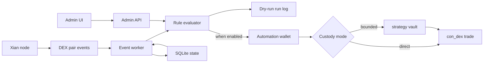

# xian-dex-automation

`xian-dex-automation` is the deterministic event-driven automation service
for the Xian DEX. It watches DEX pair events, evaluates explicit rules, and
optionally executes swaps from a dedicated automation wallet, with an
admin API and a built-in admin UI.

It is deliberately separate from neighbouring projects:

- `xian-dex-automation` — predictable, rule-driven execution.
- `xian-intentkit` — agent workflows where an AI model decides what to do.
- `xian-dex` (the DEX website) — the human trading and liquidity UI.

## Service Shape



## Quick Start

Set up a local environment:

```bash
cd xian-dex-automation
uv sync --extra dev
cp config.example.yaml config.yaml
export XIAN_DEX_AUTOMATION_ADMIN_TOKEN="$(python3 -c 'import secrets; print(secrets.token_urlsafe(32))')"
```

Validate the config:

```bash
uv run xian-dex-automation validate-config --config config.yaml
```

Run the API (admin UI at `http://127.0.0.1:8787`):

```bash
uv run xian-dex-automation serve --config config.yaml --host 127.0.0.1 --port 8787
```

For IPv6 loopback-only access, bind to `::1` and open
`http://[::1]:8787`:

```bash
uv run xian-dex-automation serve --config config.yaml --host ::1 --port 8787
```

Enter `XIAN_DEX_AUTOMATION_ADMIN_TOKEN` in the admin UI to unlock rule,
wallet, config, and evaluation endpoints. `GET /` and `GET /health` stay
public for local page load and health checks; every other API endpoint requires
`Authorization: Bearer <token>`.

Run the worker:

```bash
uv run xian-dex-automation run-worker --config config.yaml
```

For local operator testing, run API + worker in one process:

```bash
uv run xian-dex-automation serve --config config.yaml --host 127.0.0.1 --port 8787 --with-worker
```

### Enabling Execution

Provide a private key and opt in:

```bash
export XIAN_DEX_AUTOMATION_PRIVATE_KEY=...
# or set wallet.private_key_file in config.yaml
# or set XIAN_DEX_AUTOMATION_PRIVATE_KEY_FILE to a key file
```

Then set `wallet.execute: true` in `config.yaml` (or via the admin UI). The
admin UI can also generate, rotate, or import the configured service wallet
key file after it is unlocked with the admin token. It cannot change the
key-file path over HTTP. Any key change forces `wallet.execute: false`, so a
new or imported wallet always starts in dry-run mode.

For on-chain custody, set `custody.mode: strategy_vault` and copy the exact
deployed pair, direction, keeper, trade/budget, slippage, cooldown, and deadline
limits into `custody.strategy_vault`. Rules outside that envelope are rejected.
The service calls the vault's constrained `execute_swap` entrypoint and cannot
choose an output recipient. See [docs/WALLET_MODEL.md](docs/WALLET_MODEL.md) for
deployment and localnet exercise commands.

### Interrupted Swaps and Concurrent Evaluations

The worker journals the exact signed transaction in SQLite before broadcasting.
API evaluations and event workers using the same database on one host share an
execution lock. Only one swap may be unresolved at a time, across all rules.
Concurrent manual evaluations return `execution_busy`; event processing waits
before advancing its cursor.

On startup and at each polling interval, recovery checks the saved transaction
hash on its original RPC and chain. When execution is enabled, it may rebroadcast
the same signed bytes, nonce, and deadline. It never signs a replacement for an
unresolved transaction. Recovery works even if the rule was removed or the
signing key is unavailable. With `wallet.execute: false`, recovery only checks
receipts and does not broadcast.

`GET /runs` exposes the existing run as `pending`, including its hash and any
`details.recovery_error`. Confirmed success atomically records the run, updates
the baseline, and starts cooldown at reconciliation time. Confirmed failure or a
definitive rejection of the first broadcast records failure without advancing
rule state. A timeout, missing receipt, or rejection after an uncertain earlier
broadcast leaves the run pending and blocks new trades.

If recovery cannot establish an outcome, restore access to the original RPC and
its transaction history. Do not delete the journal or reset the database to
resume trading: the original transaction may already have executed. A pruned
receipt or expired transaction can require operator investigation; expiry alone
does not prove it never executed. Pre-upgrade submissions without a journal
cannot be recovered automatically.

Use a dedicated signer and a single database path on a local filesystem, on
Linux or macOS. Separate databases, remote filesystems, external transactions
from the same signer, and duplicated deployments are outside this coordination
boundary. Keep the adjacent `.execution.lock` file in place while any process
is running. Database path changes through the API return HTTP 409: stop all
workers and API processes before migrating the existing database. Back up the
database, including its execution journal, as one consistent SQLite snapshot.

The pause covers this automation database and its dedicated signer. It does not
lock the DEX, other wallets, or other independent automation accounts. A confirmed
failed transaction releases the queue, allowing a follow-up evaluation. If no
node can establish the original outcome, automation can remain paused indefinitely;
there is no timeout-based assumption of failure or unsafe force-clear operation.

### Live Configuration Changes

API configuration and key changes automatically drain and restart workers. A
shared configuration gate blocks new evaluations while the current evaluation
finishes and any pending transaction is reconciled. The configuration is then
published with a new revision in SQLite. Embedded and standalone workers sharing
that database close their old watcher and recreate the RPC client and signer,
even on a quiet chain. Key replacement also advances the revision when its file
path is unchanged; execution is disabled before the key file is replaced.

`GET /health` reports `configuration_status` as `draining`, `restarting`, or
`active` for the embedded worker, plus `worker_error` on startup/runtime failure.
A failed worker retries with the active settings. Configuration requests wait
while recovery is unresolved; competing writes return HTTP 409. A client timeout
does not prove the change was cancelled: read `/config.yaml` and `/health` again.

For an unavailable original RPC, submit the desired configuration with a healthy
replacement RPC on the **same chain**. Drain recovery can look up/rebroadcast the
saved transaction there, checking its original chain and hash. It falls back to
the original RPC if needed. A request to disable execution only reads receipts
during the drain. An explicit chain change finishes recovery on the original
chain before applying the new settings.

Changing RPC, chain, or DEX contracts resets event cursors and price baselines;
changing a rule's pair resets that rule's baseline. Cooldown timestamps are kept.
Other rule edits retain their existing market baseline. Local file/environment
edits require restarting the affected processes; API changes are shared through
the database. Do not remove either `.execution.lock` or `.configuration.lock`
while any process is running. Event delivery remains replayable after a crash.

### Stack-Managed Sidecar

When this repo lives next to `xian-stack`, the backend runs it as an
optional sidecar:

```bash
cd ../xian-stack
export XIAN_DEX_AUTOMATION_ADMIN_TOKEN="$(python3 -c 'import secrets; print(secrets.token_urlsafe(32))')"
python3 ./scripts/backend.py start     --no-bds-enabled --dex-automation
python3 ./scripts/backend.py endpoints --no-bds-enabled --dex-automation
```

Default URL: `http://127.0.0.1:38280`. The stack-managed path creates a
dedicated local key file at
`xian-stack/.artifacts/dex-automation/wallet.key` and keeps the service in
dry-run mode until execution is explicitly enabled. Enter the admin token in
the UI to manage rules, wallet settings, config, and manual evaluations.

Existing service configurations keep their configured key source unless an
operator explicitly overrides it. The stack generates a default key only when
creating a configuration. Strategy-vault bootstrap and stack key creation refuse
existing empty key files; restore the intended keeper key instead of replacing
its identity automatically.

Inspect the configured credential source without reading key files or contacting
a node:

```bash
uv run python -m xian_dex_automation.credentials --config config.yaml
```

The JSON result contains only `kind` (`environment`, `file`, or `null`) and
`source` (the environment-variable name, absolute file path, or `null`). Selection
uses the same precedence as execution: the configured private-key environment
variable, then the configured file environment variable, then the configured
file path. Relative config paths resolve beside the configuration; relative
file environment overrides resolve from the process working directory. This
describes the selected source, not whether its key is present or valid.

## Principles

- **Deterministic, rule-driven execution.** The service evaluates explicit
  rules; no learned policies, no agent reasoning loop. Use
  `xian-intentkit` if that is what you want.
- **Browser wallets cannot drive automation.** Browser wallets are
  interactive and require user presence per transaction. Unattended
  automation uses a dedicated automation wallet. A stricter strategy / vault
  model can constrain what an off-chain keeper can trigger.
- **Explicit custody boundary.** Direct mode is bounded by the service-wallet
  balance. Strategy-vault mode is bounded on-chain by pair/direction/action,
  per-trade and cumulative spend, slippage, cooldown, deadline, keeper, and
  withdrawal controls.
- **Default to dry-run.** Execution is opt-in. Generated, rotated, or
  imported wallets always start with `wallet.execute: false`.
- **Local-only by default.** API and admin UI bind to `127.0.0.1` by default
  and can bind to IPv6 loopback with `--host ::1`. The UI talks to the same
  local API, never returns private key material, and requires an admin bearer
  token for non-health API access. Non-loopback binds are refused unless
  `XIAN_DEX_AUTOMATION_ADMIN_TOKEN` is configured.
- **Independent of the DEX repo.** This service is event-driven and lives
  outside `xian-dex`; the DEX repo owns contracts and frontend, this repo
  owns automation.

## Wallet Model

1. **Dedicated automation wallet.** Generate a wallet,
   fund it with a limited budget, run this service with that private key.
2. **On-chain strategy vault.** A user-owned deployed contract holds a bounded
   budget and the off-chain keeper can only trigger its fixed exact-input swap
   under hard on-chain limits.

Both models are implemented and both default to dry-run. The local admin UI
exposes the configured custody envelope; contract deployment and owner actions
are intentionally separate human-approved setup steps.

## Rule Shape

- **Trigger** `price_move` — stores the first observed pair price as a
  baseline, fires when the pair price moves by the configured basis points
  from that baseline. After a dry-run or executed action, the current
  price becomes the new baseline.
- **Action** `swap_exact_in` — quotes the configured input amount, applies
  `max_slippage_bps`, and calls `con_dex.swapExactTokenForToken` when
  execution is enabled.

See [config.example.yaml](config.example.yaml) for the full shape.

## API Surface

When the API is running:

- `GET    /` — public admin UI shell
- `GET    /health` — public health check
- `GET    /rules` — requires `Authorization: Bearer <token>`
- `PUT    /rules/{rule_id}` — requires `Authorization: Bearer <token>`
- `DELETE /rules/{rule_id}` — requires `Authorization: Bearer <token>`
- `GET    /runs` — requires `Authorization: Bearer <token>`
- `GET    /wallet` — requires `Authorization: Bearer <token>`
- `GET    /custody` — requires `Authorization: Bearer <token>`
- `PATCH  /wallet` — requires `Authorization: Bearer <token>`
- `POST   /wallet/generate` — requires `Authorization: Bearer <token>`
- `POST   /wallet/import` — requires `Authorization: Bearer <token>`
- `GET    /config.yaml` — requires `Authorization: Bearer <token>`
- `PUT    /config.yaml` — requires `Authorization: Bearer <token>`
- `POST   /evaluate/{pair_id}` — requires `Authorization: Bearer <token>`

`POST /evaluate/{pair_id}` evaluates matching rules once. In dry-run mode
it records what would have happened without submitting a transaction.
Rejected transactions and failed execution receipts are logged as failed runs
with their transaction hash when available. They leave the rule's baseline and
cooldown unchanged.

## Key Directories

- `src/xian_dex_automation/` — service code:
  - `cli.py` — `xian-dex-automation` console entrypoint (`validate-config`,
    `serve`, `run-worker`).
  - `service.py` — FastAPI service and admin API.
  - `worker.py` — event watcher and rule-evaluation loop.
  - `rules.py` — trigger and action implementations.
  - `dex.py` — DEX-side reads, quotes, and submission.
  - `storage.py` — SQLite-backed persistence (rules, runs, baselines,
    wallet metadata).
  - `config.py` — typed config schema.
- `web/` — built-in admin UI assets.
- `contracts/` — constrained on-chain strategy-vault source and deployment notes.
- `scripts/` — dry-run-by-default localnet vault bootstrap/exercise helper.
- `state/` — local SQLite state.
- `tests/` — unit, frontend, and opt-in live-node coverage.
- `docs/` — architecture and wallet-model notes.

## Validation

```bash
uv run --extra dev ruff check .
uv run --extra dev pytest
uv run --extra dev python -m compileall src tests
```

Optional live-node test against a local node that already has the DEX
contracts and a liquid pair:

```bash
XIAN_DEX_AUTOMATION_LIVE_RPC_URL=http://127.0.0.1:26657 \
XIAN_DEX_AUTOMATION_LIVE_PAIR_ID=1 \
uv run --extra dev pytest tests/test_live_node.py -q
```

Full localnet strategy-vault deployment and a keeper-triggered swap:

```bash
uv run --extra dev python scripts/bootstrap_strategy_vault.py --execute --execute-swap
```

The stack's mandatory `07-dex-automation-recovery` phase runs
`scripts/recovery_smoke.py` against the canonical DEX bundle on five validators.
It checks concurrent evaluation, process death after broadcast, recovery through
another validator during a config change, an on-chain revert followed by a
successful swap, and an unrelated wallet transacting while automation is pending.
Receipts and token balances must agree on all five nodes; successful swaps must
consume exactly one nonce and one input debit. The harness uses dedicated funded
test wallets and deletes its temporary private-input file.

GitHub Actions runs lint, unit / frontend tests, and compile checks on
pushes and pull requests to `main`. The live-node test is skipped in CI
unless the environment variables above are provided.

## Related Docs

- [AGENTS.md](AGENTS.md) — repo-specific guidance for AI agents and contributors
- [docs/ARCHITECTURE.md](docs/ARCHITECTURE.md) — major components and dependency direction
- [docs/WALLET_MODEL.md](docs/WALLET_MODEL.md) — wallet model and security boundary
- [config.example.yaml](config.example.yaml) — annotated example config
